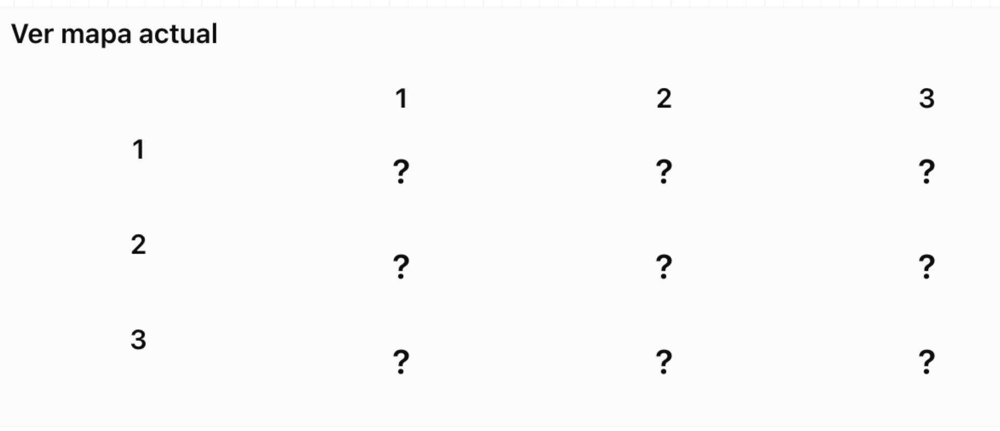
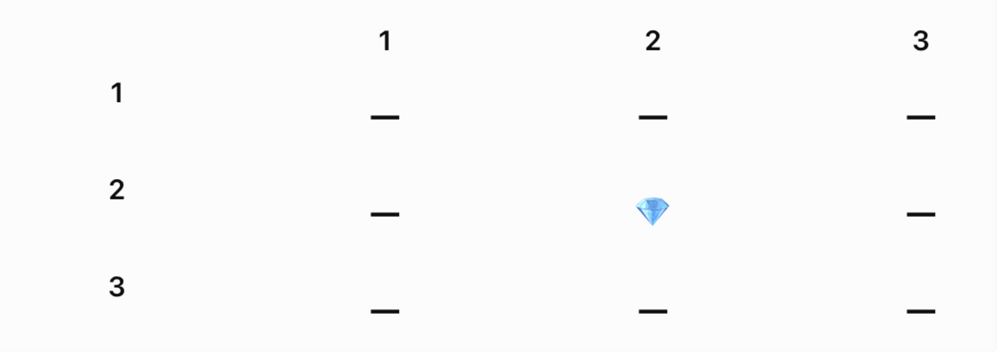
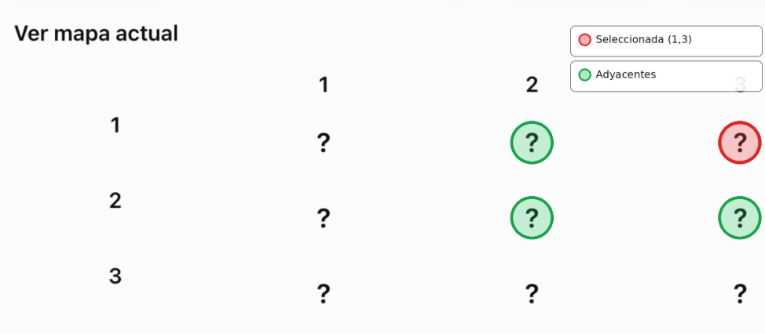

# PROYECTO: EL BUSCADOR DEL TESORO

## Objetivo principal

Desarrollar una aplicación de consola en Python que permita gestionar un juego de búsqueda del tesoro mediante una matriz bidimensional generada aleatoriamente.

La aplicación permitirá que diferentes usuarios registrados puedan iniciar sesión, seleccionar el nivel de dificultad de la partida y tratar de encontrar un tesoro oculto en una matriz. El sistema deberá controlar los intentos realizados, proporcionar pistas cuando corresponda y registrar los resultados de las partidas durante la ejecución del programa.

Además, existirá un perfil de administrador con funcionalidades adicionales de supervisión, que permitirá consultar el estado de las partidas y acceder a las estadísticas generales de la sesión.

El proyecto pretende integrar diferentes conceptos de programación en Python, como la programación modular, el uso de funciones, estructuras de datos, matrices bidimensionales, gestión de ficheros, programación orientada a objetos (si se considera oportuno), tratamiento de excepciones y representación gráfica de información.

## Requisitos

### Req001 Sistema de autenticación y gestión de usuarios

La aplicación deberá disponer de un sistema de autenticación mediante usuario y contraseña.

- Existirá un fichero externo que almacenará los usuarios y sus correspondientes contraseñas.
- Únicamente podrán acceder a la aplicación los usuarios que estén registrados en dicho fichero.
- El sistema deberá diferenciar dos tipos de perfiles:
  - **Administrador:** tendrá acceso a las funcionalidades de administración y supervisión.
  - **Usuario:** podrá iniciar y jugar partidas, consultar sus resultados y acceder a las funcionalidades permitidas para su perfil.
- La aplicación deberá solicitar las credenciales antes de permitir el acceso al menú principal.
- Se deberá controlar el acceso a las diferentes opciones en función del perfil del usuario autenticado.

### Req002 Configuración de la partida y niveles de dificultad

Antes de comenzar una partida, el usuario deberá poder seleccionar el nivel de dificultad.

Se establecerán tres niveles:

| Dificultad | Tamaño de la matriz |
|---|---|
| Básica | 5 x 5 |
| Media | 8 x 8 |
| Avanzada | 10 x 10 |

El tamaño de la matriz determinará la dificultad del juego.

Una vez seleccionado el nivel:

- El sistema generará una matriz bidimensional cuadrada.
- La posición del tesoro se establecerá de forma aleatoria.
- El tesoro permanecerá oculto durante el desarrollo de la partida.
- El usuario deberá indicar las coordenadas de la casilla en la que considera que se encuentra el tesoro.
- El sistema comprobará si las coordenadas introducidas son correctas.
- Se deberá controlar que las coordenadas introducidas se encuentren dentro de los límites de la matriz.

### Req003 Desarrollo de la partida

El usuario deberá disponer de un sistema de juego que le permita realizar intentos hasta encontrar el tesoro.

Para ello:

- El usuario introducirá las coordenadas de la casilla que desea comprobar.
- El sistema indicará si ha encontrado el tesoro o si debe continuar buscando.
- Se contabilizará el número de intentos realizados en cada partida.
- No se permitirá seleccionar nuevamente una casilla que ya haya sido comprobada.
- Cuando el usuario encuentre el tesoro, la partida finalizará y se mostrará un mensaje indicando que ha ganado.
- El sistema registrará el resultado de la partida y el número de intentos necesarios para encontrar el tesoro.

### Req004 Sistema de pistas

La aplicación deberá incorporar un sistema de pistas para ayudar al usuario durante la búsqueda.

- El sistema permitirá utilizar pistas una vez que el usuario haya realizado más de tres intentos sin encontrar el tesoro.
- Existirá una opción específica en el menú de juego para solicitar una pista.
- La pista indicará si la posición seleccionada se encuentra cerca o lejos del tesoro.
- Se considerará que una casilla está cerca cuando el tesoro se encuentre en una posición adyacente a la casilla seleccionada.
- Se considerará que una casilla está lejos cuando no exista adyacencia con la posición del tesoro.
- Se deberá tener en cuenta la adyacencia horizontal, vertical y diagonal.
- Las pistas no revelarán directamente la posición del tesoro.

### Req005 Funcionalidades del administrador

El administrador dispondrá de funcionalidades adicionales que no estarán disponibles para los usuarios normales.

Entre ellas:

- Consultar el estado actual de la matriz de una partida.
- Visualizar la posición real del tesoro.
- Consultar las casillas que ya han sido seleccionadas.
- Acceder a la información de las partidas que se estén desarrollando.
- Consultar los resultados y estadísticas generales de la sesión.

La visualización de la matriz por parte del administrador deberá mostrar claramente las casillas exploradas, las casillas pendientes y la posición del tesoro.

### Req006 Sistema de registro y trazabilidad

La aplicación deberá incorporar un sistema de registro de eventos (*logging*) que permita realizar un seguimiento de las acciones realizadas durante la ejecución del programa.

Se deberán registrar, como mínimo, los siguientes acontecimientos:

- Inicio y finalización de la aplicación.
- Intentos de inicio de sesión, tanto correctos como incorrectos.
- Usuario que inicia sesión.
- Inicio de una nueva partida.
- Nivel de dificultad seleccionado.
- Coordenadas seleccionadas en cada intento.
- Solicitud y resultado de las pistas.
- Finalización de las partidas.
- Resultado de cada partida (ganada o abandonada).
- Número de intentos realizados.

Los registros deberán almacenarse en un fichero externo mediante el módulo `logging` de Python.

Se deberá incluir información suficiente para identificar el momento en el que se produce cada evento y el usuario al que corresponde.

### Req007 Sistema de estadísticas

La aplicación deberá disponer de un apartado de estadísticas accesible desde el menú principal.

Las estadísticas mostrarán información correspondiente a las partidas realizadas durante la sesión actual de ejecución del programa.

Se deberán contemplar, como mínimo, los siguientes indicadores:

- Número total de partidas iniciadas.
- Número total de partidas finalizadas.
- Número de partidas ganadas.
- Número de partidas abandonadas.
- Porcentaje de partidas ganadas respecto al total de partidas finalizadas.
- Número total de intentos realizados.
- Media de intentos necesarios para encontrar el tesoro en las partidas ganadas.
- Número de partidas ganadas según el nivel de dificultad.
- Número de partidas realizadas por cada usuario.

Además, se deberá incorporar una funcionalidad que permita representar gráficamente parte de la información mediante gráficos generados con alguna biblioteca de Python, como `matplotlib`.

Como mínimo, se deberán representar:

- Un gráfico con el número de partidas ganadas y perdidas.
- Un gráfico con el número de partidas realizadas según el nivel de dificultad.

### Req008 Gestión de partidas y datos en memoria

La aplicación deberá gestionar la información de las partidas durante su ejecución.

- Los datos de las partidas se almacenarán en estructuras de datos en memoria.
- Se deberá mantener un registro de las partidas realizadas por cada usuario durante la sesión.
- Las estadísticas se calcularán utilizando la información almacenada en memoria.
- Al finalizar la ejecución del programa, la información relativa a las partidas y sus estadísticas se perderá.

**Importante:** la aplicación no deberá implementar persistencia de las partidas ni de las estadísticas. El único fichero destinado a almacenar información de usuarios será el fichero de credenciales. Los registros de eventos se conservarán en el fichero de logging, pero no se utilizarán para recuperar el estado de las partidas ni para reconstruir las estadísticas en ejecuciones posteriores.

### Req009 Menú principal

La aplicación deberá disponer de un menú principal adaptado al perfil del usuario autenticado.

El menú deberá permitir acceder a las diferentes funcionalidades del sistema.

Como mínimo, deberá contemplar:

- Iniciar una nueva partida.
- Consultar las estadísticas de la sesión.
- Consultar el historial de partidas de la sesión.
- Cerrar sesión.
- Salir de la aplicación.

Las opciones adicionales de administración únicamente aparecerán cuando el usuario autenticado tenga el perfil de administrador.

##  Validación y tratamiento de errores

La aplicación deberá contemplar un sistema adecuado de validación de datos y tratamiento de excepciones.

Se deberán controlar, entre otras, las siguientes situaciones:

- Introducción de coordenadas no numéricas.
- Introducción de coordenadas fuera de los límites de la matriz.
- Selección de casillas que ya han sido exploradas.
- Selección de opciones inexistentes en los menús.
- Introducción de credenciales incorrectas.
- Errores relacionados con la lectura del fichero de usuarios.
- Situaciones que puedan provocar errores durante el desarrollo de una partida.

La aplicación no deberá finalizar inesperadamente como consecuencia de una entrada incorrecta del usuario.

## Organización y estructura del proyecto

El proyecto deberá estar organizado de forma modular, separando las diferentes responsabilidades de la aplicación.

Se deberá evitar implementar toda la lógica del programa en un único fichero.

Se valorará una correcta distribución del código en diferentes módulos y ficheros, así como el uso de funciones con responsabilidades bien definidas.

El código deberá ser legible, estar correctamente indentado y utilizar nombres descriptivos para variables, funciones y clases.

Se deberá incluir un fichero `README.md` que explique cómo instalar, configurar y ejecutar la aplicación.

## Entrega

Se realizará una realease del repositorio sobre la rama main antes del 22 de noviembre a las 23:59.

El código será defendido en clase durante 20 min cada grupo. Cualquier código que no pueda ser defendido el Req será evaluado como no conseguido. 

Añadir una tabla resumen de quien ha realizado cada uno de los requisitos del programa. Ambas personas pueden haber realizado un requisito.

La práctica puede hacerse de forma individual o por parejas, rellenar el siguiente enlace donde se establecerá la hora de la defensa obligatoria.

https://docs.google.com/spreadsheets/d/1V4IpR9JgrR1lbaFasZR3vBl4fGDjmn07SDXpe6BahDc/edit?gid=0#gid=0

## Rúbrica de evaluación

| Puntuación | Nivel de consecución | Descripción |
|---|---|---|
| 0 - 4 | No funcional | La aplicación no funciona correctamente o presenta errores que impiden utilizar las funcionalidades principales. |
| 4,1 - 7,9 | Funcional con errores | La aplicación funciona parcialmente, pero presenta errores o funcionalidades que no se han implementado correctamente. |
| 8 - 10 | Funcional correctamente | La aplicación funciona correctamente y cumple los requisitos establecidos en el enunciado. |

## Criterios de evaluación

### RA4 – Adapta sistemas ERP-CRM

| Criterios de evaluación |
|---|
| a) Se han identificado las necesidades y funcionalidades que debe incorporar la aplicación. |
| b) Se han definido las estructuras de datos necesarias para gestionar la información de la aplicación. |
| c) Se han desarrollado consultas para obtener información sobre las partidas y sus resultados. |
| d) Se han adaptado las interfaces de entrada de datos y los procesos de interacción con el usuario. |
| e) Se han generado informes con los resultados de las partidas. |
| f) Se han creado paneles de estadísticas y representaciones gráficas. |
| g) Se han implementado procedimientos para gestionar los registros y eventos de la aplicación. |
| h) Se han realizado pruebas para comprobar el funcionamiento de la aplicación. |
| i) Se han documentado las operaciones realizadas y las incidencias observadas. |
| j) Se han integrado los diferentes componentes desarrollados en la aplicación. |

### RA5 – Desarrolla componentes para un sistema ERP-CRM

| Criterios de evaluación |
|---|
| a) Se han reconocido las sentencias y estructuras propias del lenguaje Python. |
| c) Se han desarrollado y modificado componentes software para añadir nuevas funcionalidades a la aplicación. |
| d) Se han integrado los nuevos componentes software en la aplicación. |
| e) Se ha verificado el correcto funcionamiento de los componentes creados. |
| f) Se han documentado todos los componentes creados o modificados. |
| g) Se ha analizado y organizado la arquitectura de la aplicación. |